# 🛍️ ShopFlow — Flutter E-Commerce App

A full-stack e-commerce mobile application built with **Flutter & Dart**, featuring Firebase integration, BLoC/Cubit state management, Clean Architecture, and a Cloudflare Worker backend for secure order processing.

## 🚀 Features

### Customer Features
- User registration and login with Firebase Authentication
- Password reset
- Browse products and view product details
- Add products to cart and manage quantities
- Checkout and place orders
- View order history and order details
- Product stock validation during order processing

### Admin Features
- Admin dashboard
- Add and edit products
- Manage product inventory
- View customer orders
- Update order statuses

## 🛠️ Tech Stack

| Technology | Purpose |
|---|---|
| Flutter & Dart | Cross-platform application development |
| Firebase Authentication | User authentication |
| Cloud Firestore | Product and order data |
| BLoC / Cubit | State management |
| Clean Architecture | Separation of application layers |
| GetIt | Dependency injection |
| Cloudflare Workers | Backend order processing |
| Cloudflare KV | Backend caching |
| Git & GitHub | Version control |

## 🏗️ Architecture

The application follows Clean Architecture principles, separating business logic, data access, and user interface components.

```text
lib/
├── core/
│   ├── constants/
│   ├── network/
│   ├── theme/
│   └── injection_container.dart
├── features/
│   └── auth/
│       ├── data/
│       │   ├── datasources/
│       │   └── repositories/
│       ├── domain/
│       │   ├── entities/
│       │   ├── repositories/
│       │   └── usecases/
│       └── presentation/
│           ├── bloc/
│           ├── cubit/
│           └── pages/
└── main.dart
```

## 🔐 Backend & Order Processing

ShopFlow uses a Cloudflare Worker to process orders and communicate with Firebase securely.

The order-processing flow includes:

1. Authenticate the customer.
2. Validate the requested products and quantities.
3. Check product availability.
4. Create the order in Cloud Firestore.
5. Update product stock.

Firebase Admin credentials are managed through server-side environment secrets and are not included in the repository.


## 📱 Screenshots

### Customer App

| Login | Register | Products |
|---|---|---|
| 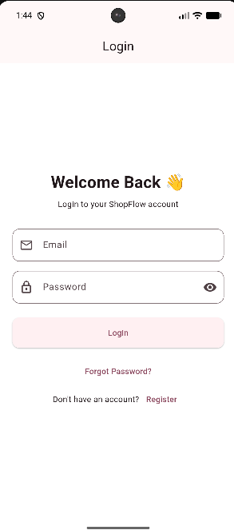 | 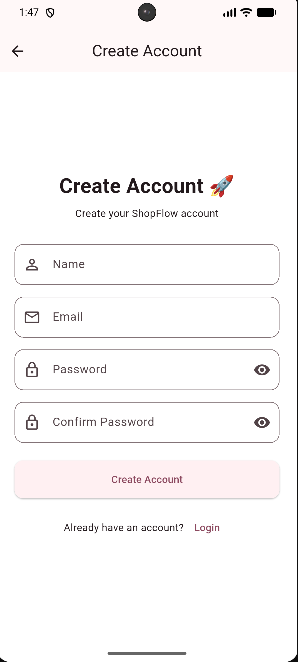 | 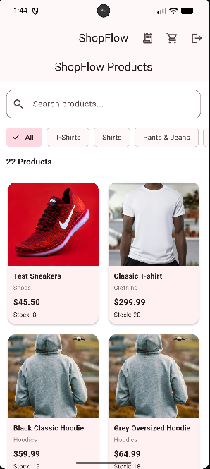 |

| Product Details | Cart | Checkout |
|---|---|---|
| 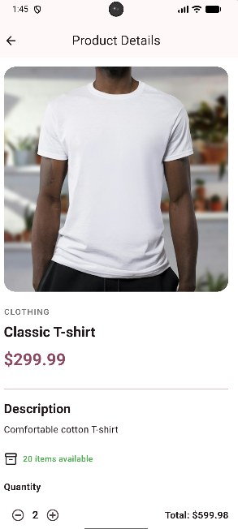 | 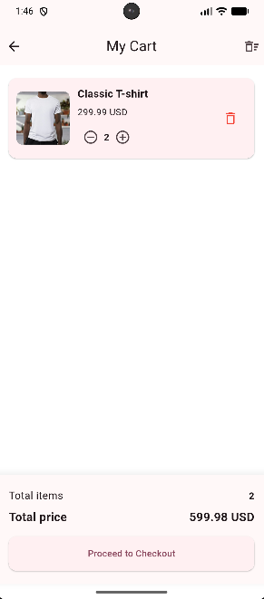 | 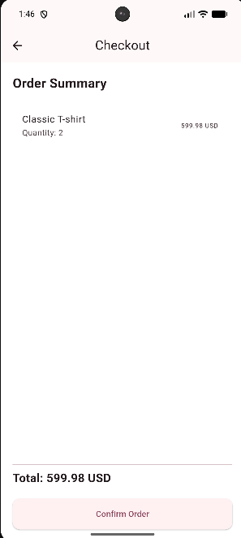 |

| My Orders | Order Details |
|---|---|
| 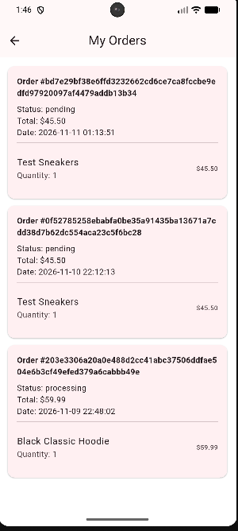 | 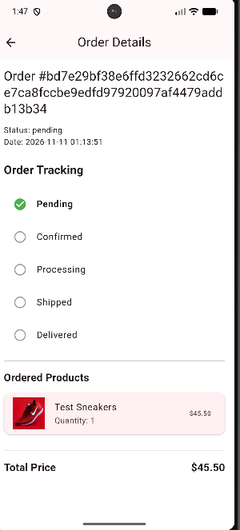 |

### Admin Panel

| Dashboard | Manage Products | Manage Orders |
|---|---|---|
| 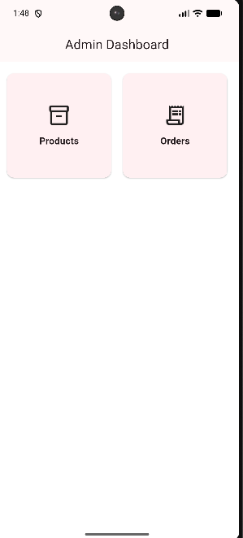 | 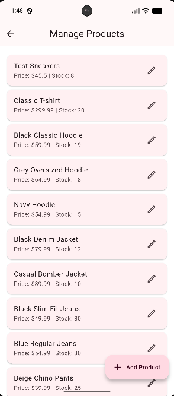 | 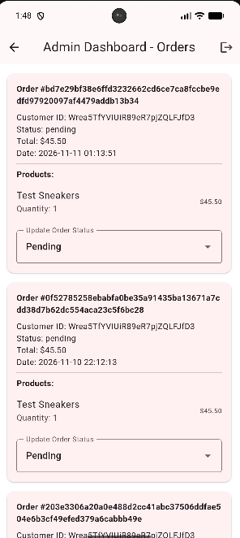 |


## ⚙️ Getting Started

### Prerequisites

- Flutter SDK
- Dart SDK
- Android Studio or VS Code
- A Firebase project

### Installation

Clone the repository:

```bash
git clone https://github.com/Omar-Elsharqawy/ShopFlow.git
cd ShopFlow
```

Install dependencies:

```bash
flutter pub get
```

Configure Firebase for your own project using FlutterFire CLI:

```bash
flutterfire configure
```

Run the application:

```bash
flutter run
```

**Note:** Backend order processing requires a properly configured Cloudflare Worker and Firebase Admin credentials. The deployed backend is not intended as a public development environment.

## 👨‍💻 Developer

**Omar Elsharqawy**

Flutter Developer | Mobile App Developer

- GitHub: https://github.com/Omar-Elsharqawy
- LinkedIn: https://www.linkedin.com/in/omar-elsharqawy-552b403a2

## 📌 Project Status

Core customer shopping flows, Firebase integration, order processing, and admin management features have been implemented. Further UI improvements, testing, and documentation are ongoing.
